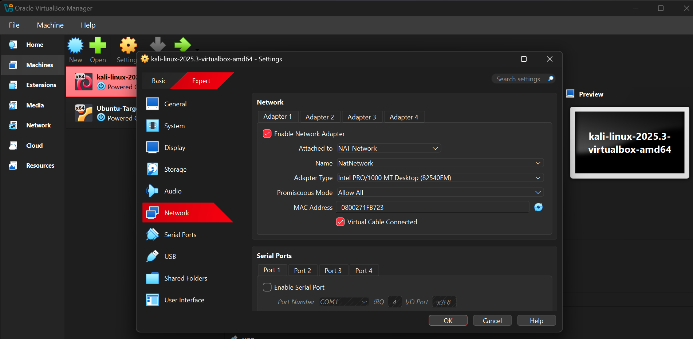

# 🔐 Cybersecurity Lab Environment Setup

- **Student:** Zamzam Mohamed Sheikh
- **Program:** Cybersecurity at NetworkWalks
- **Batch:** B084E
- **Week:** 01
- **Project:** Cybersecurity Lab Setup
- **Instructor:** Waqas Karim, CCIE

---

## 1. Project Overview

In this project, I set up a virtual cybersecurity lab on my laptop using Oracle VirtualBox and Kali Linux. The lab provides a separate environment where I can practice cybersecurity tools without directly affecting my main operating system.

I installed and configured the virtual machine, set up the network, assigned a static IP address, and tested the connection. This lab will help me practice more cybersecurity tasks during my internship at NetworkWalks.

---

## 2. Objectives

The main objectives of this project were to:

- Upgrade and configure VirtualBox.
- Set up Kali Linux as a virtual machine.
- Create a private NAT Network.
- Configure the network connection in Kali Linux.
- Assign a static IP address.
- Test internet connectivity and DNS resolution.
- Create a clean snapshot of the virtual machine.
- Identify and solve problems encountered during setup.
- Prepare the lab for future cybersecurity projects.

---

## 3. Lab Configuration

| Component                 | Configuration            |
| ------------------------- | ------------------------ |
| Host Laptop               | Dell Latitude 7480       |
| Host Operating System     | Windows 11               |
| RAM                       | 8 GB                     |
| Processor                 | Intel Core i5            |
| Hypervisor                | Oracle VirtualBox 7.2.22 |
| Security Operating System | Kali Linux 2025.3        |
| Kali RAM                  | 2048 MB                  |
| Network Type              | NAT Network              |
| Network Name              | NatNetwork               |
| Network Address           | 10.0.0.0/24              |
| Kali IP Address           | 10.0.0.2/24              |
| Gateway                   | 10.0.0.1                 |
| DNS Server                | 8.8.8.8                  |

---

## 4. Lab Architecture

My lab consists of a Dell laptop running Windows 11, with Oracle VirtualBox running Kali Linux as a virtual machine.

The Kali Linux virtual machine is connected to a private NAT Network. I configured a static IP address so that the machine could use a consistent address during my cybersecurity practice.

This setup provides an environment for learning networking, using security tools, and carrying out authorized security tests. Other virtual machines can also be added to the network for future lab activities.

---

## 5. Setup Procedure

### Step 1: Upgrade VirtualBox

I upgraded my existing VirtualBox installation to the required version, as instructed. This was done to make sure I was using the correct version for the lab setup.

### Step 2: Set Up Kali Linux

I set up Kali Linux as a virtual machine in VirtualBox and allocated 2048 MB of RAM. I checked the virtual machine settings to make sure the necessary resources were available before starting Kali Linux.

### Step 3: Create a NAT Network

I created a private NAT Network named `NatNetwork` in VirtualBox.

The network was configured to provide connectivity for the Kali Linux virtual machine. I also checked the network settings to make sure they matched the requirements of the lab.

### Step 4: Configure the Network

I connected the Kali Linux virtual machine to `NatNetwork` and configured a static IPv4 address.

I configured the IP address, subnet, gateway, and DNS settings. This helped keep the machine's network configuration consistent for future cybersecurity activities.

### Step 5: Test Network Connectivity

After configuring the network, I opened the terminal in Kali Linux and ran the following command:

```bash
ping -c 3 google.com
```

The command sent three packets to Google. All three packets were received, with 0% packet loss.

This showed that internet connectivity and DNS resolution were working during the test.

### Step 6: Create a Snapshot

After completing the setup and checking the network connection, I created a snapshot of the virtual machine to save its current state.

A snapshot provides a recovery point that I can return to if I encounter problems while working on future cybersecurity projects.

---

## 6. Lab Verification

I used Linux commands to check the network configuration and connectivity of my Kali Linux machine.

| Test                  | Command                | Purpose                                                    |
| --------------------- | ---------------------- | ---------------------------------------------------------- |
| Check IP address      | `ip a`                 | To view the IP address assigned to Kali Linux              |
| Check network routes  | `ip route`             | To view the network routes and default gateway             |
| Test internet and DNS | `ping -c 3 google.com` | To check connectivity and domain name resolution           |
| Test DNS separately   | `nslookup google.com`  | To check whether the domain name resolves to an IP address |
| Check Nmap            | `nmap --version`       | To check whether Nmap is installed and available           |

The ping test was successful, with all three packets received and 0% packet loss. This confirmed that internet connectivity and DNS resolution were working at the time of testing.

---

## 7. Problems Encountered and How I Solved Them

### Problem 1: Kali Linux Froze During Boot

After upgrading VirtualBox, Kali Linux stopped during startup at a message related to RETBleed and failed to continue loading.

I checked the virtual machine settings, including the graphics configuration, RAM allocation, and I/O APIC. I also investigated a possible conflict with the Windows Virtual Machine Platform feature.

After troubleshooting the issue and adjusting the setup, I managed to get Kali Linux working again.

### Problem 2: Laptop Screen Flickering

During the troubleshooting process, my laptop screen started flickering. I tried using Windows Safe Mode and checked the Intel graphics driver. I removed the driver and installed the driver recommended for my Dell laptop.

When the flickering continued, I used System Restore to return Windows to an earlier restore point from before the VirtualBox upgrade.

After restoring the system, I was able to continue working on my lab.

### Problem 3: Firefox Could Not Restore Previous Pages

When I opened Firefox in Kali Linux, it displayed a message saying that it could not restore my previous pages.

I selected the option to start a new session and tested the network using the ping command.

The test was successful, which showed that the network connection was working and that the Firefox message was a separate issue.

---

## 8. What I Learned

During this project, I learned:

- How to upgrade and configure VirtualBox.
- How to set up Kali Linux as a virtual machine.
- The difference between a virtual machine and the main operating system.
- How to configure a NAT Network and a static IP address.
- How to check IP addresses, network routes, and DNS settings.
- How to test network connectivity using Linux commands.
- How to troubleshoot virtual machine startup problems.
- How to use Windows Safe Mode and System Restore when troubleshooting Windows issues.
- Why it is important to document problems and the steps taken to solve them.

This project helped me understand that troubleshooting requires patience and checking possible causes one step at a time.

---

## 9. Security and Ethical Use

This lab is intended for educational purposes and authorized cybersecurity practice only.

Any scanning, testing, or other security activities will be carried out on systems I own or have permission to test.

---

## 10. Tools Used

- 7-Zip
- Oracle VirtualBox
- Kali Linux
- Windows 11
- Windows Safe Mode and System Restore
- Linux terminal commands
- Nmap
- GitHub Desktop

---

## 11. Conclusion

In conclusion, I set up my cybersecurity lab using Oracle VirtualBox and Kali Linux. I configured the virtual machine, connected it to the NAT Network, assigned a static IP address, and tested connectivity.

I also encountered problems during the process, including Kali Linux startup issues and laptop screen flickering. I worked through these issues and managed to get my lab working.

This project gave me practical experience with virtual machines, networking, and troubleshooting. The lab will provide a starting point for practicing more cybersecurity skills during my internship at NetworkWalks.
## 12. Screenshots

### Task One


### Kali Setup


### Kali Network


### Network

